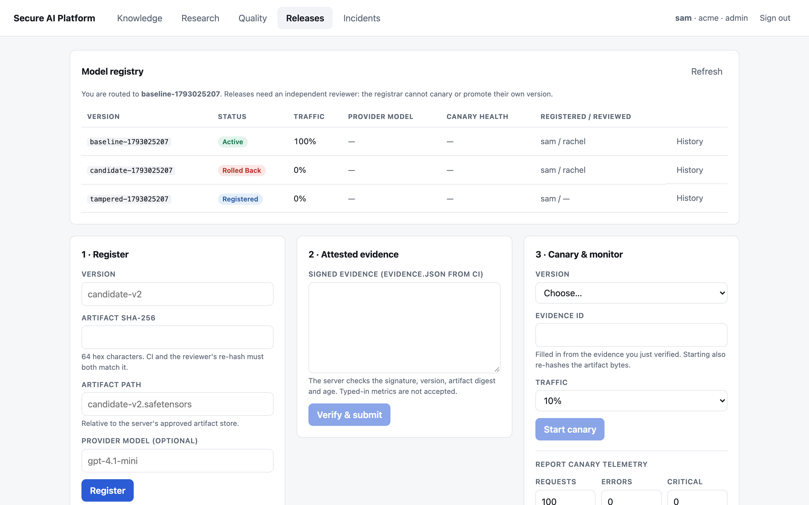
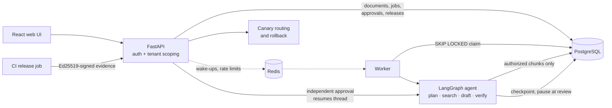

# Secure AI Engineering Platform


**Multi-tenant RAG and agent research with security built in.** Tenant-isolated retrieval, a LangGraph research agent that pauses for independent human review, signed model releases with canary rollback, and local PII redaction. It runs fully offline by default, with no API key needed.

*Final capstone of the Complete AI Engineer & Safe AI Engineering course (lessons 1–12).*



> **Scope:** this project demonstrates specific engineering safeguards; it is not a production-certified system. The default answer mode **extracts passages** and does not call an LLM. The optional LLM writer needs explicit configuration and its own factuality and prompt-injection evaluation.

## Results

| Measure | Result |
|---|---|
| Retrieval, 61 labeled questions (MiniLM hybrid) | Recall@3 **0.943**, MRR **0.929** |
| Cross-tenant leaks across all retrieval modes | **0** |
| Prompt-injection suite, offline writer | **0 of 30** attacks succeeded |
| Test suite, no external services | **145 passed**, 4 skipped (need PostgreSQL/Redis) |

Details and caveats: [`docs/EVALUATION.md`](docs/EVALUATION.md) and [`TEST_REPORT.md`](TEST_REPORT.md).

## Features

- **Tenant-isolated RAG.** Documents are filtered by tenant and group *before* any scoring. BM25, dense and hybrid (RRF) retrieval, with an approved `all-MiniLM-L6-v2` embedding model as an option.
- **Durable research agent.** LangGraph runs `plan → search → draft → verify → review`, checkpointed in PostgreSQL. The agent stops at review and resumes after restarts.
- **Independent human approval.** Approval is enforced in the database: the reviewer must be in the same tenant and cover the job's groups, and authors cannot approve their own work.
- **Signed model releases.** Before a canary starts, CI signs a benchmark report with Ed25519 and the server re-hashes the model file. Evidence rows can't be edited or deleted, enforced by database triggers.
- **Canary routing and rollback.** Users are assigned to a version and stay on it. High error rates roll the canary back automatically and open an incident.
- **Privacy.** PII is redacted on this machine before storage and before any outbound LLM call (regex by default, Presidio as an option).
- **Quality gates.** Precision, recall and F1 with Wilson intervals per group. The release is held if any subgroup fails, even when the overall average passes.
- **Prompt-injection suite.** 30 attacks in 7 categories run through the real upload, retrieval, worker and review paths. Tests confirm each defense is what stops its attacks.
- **Accounts.** Sign up with email and password or Google. Each account gets a private workspace. Passwords are hashed with scrypt, sessions are `HttpOnly` cookies that can be revoked, and Google sign-in uses the server-side OIDC flow with PKCE.
- **Web UI.** React + TypeScript app for documents, research review, releases, quality and incidents, served behind a strict Content-Security-Policy.

More detail per feature: [`docs/FEATURES.md`](docs/FEATURES.md).

## Architecture



PostgreSQL holds the authoritative state. Redis only wakes workers up and enforces rate limits, so losing it delays work but never loses it. Full data flow, trust levels and failure model: [`docs/ARCHITECTURE.md`](docs/ARCHITECTURE.md).

## Quick start

No API key, PostgreSQL, Redis or LangGraph needed:

```bash
cd capstone
uv sync --extra test --extra production   # production adds LangGraph, psycopg, redis
uv run pytest -q
uv run python -m capstone.demo
```

Then open `artifacts/dashboard.html`, a synthetic demo of the whole flow: ingestion → tenant-isolated retrieval → research job → independent approval → model evaluation → 10% canary → simulated rollback.

Optional extras: `semantic` (approved embedding model), `privacy` (local Presidio PII detection), `llm` (OpenAI writer), `documents` (PDF loading and text splitting).

### Run the API locally (SQLite)

```bash
cp .env.example .env  # change the example secrets first
set -a; source .env; set +a
export DATABASE_URL=sqlite:///./capstone.db
export MODEL_BACKEND=offline
uv run python -m capstone.init_db
uv run uvicorn capstone.asgi:app --reload
# In another terminal, with the same environment:
CAPSTONE_GRAPH=offline uv run python -m capstone.worker
```

This mode uses SQLite and an in-process rate limiter, which are fine for learning but not for production.

### Run the full stack (Docker Compose)

```bash
cp .env.example .env
# Replace POSTGRES_PASSWORD, CAPSTONE_ROUTING_SECRET and EVERY demo bearer token.
docker compose up --build -d
docker compose logs -f api worker
```

| Service | Address |
|---|---|
| API docs | `http://127.0.0.1:${CAPSTONE_PORT:-8000}/docs` |
| Web UI | `http://127.0.0.1:${CAPSTONE_WEB_PORT:-8090}` |

Compose starts PostgreSQL, Redis, a schema initializer, the API, a separate LangGraph worker and the web UI. Only the API and UI are published, and only on `127.0.0.1`.

**Port already in use?** If another app owns port 8000, `localhost:8000` shows that app and `/health/ready` fails. Set `CAPSTONE_PORT=8002` (or any free port) in `.env`, then run `docker compose up -d --force-recreate api`. To see what owns a port: `lsof -nP -iTCP:8000 -sTCP:LISTEN`.

### Load demo data

Every tab starts empty on a fresh database. `capstone.seed` fills it through the public API, so redaction, independent review and signed release evidence all apply:

```bash
set -a; source .env; set +a
uv run python -m capstone.seed                                   # API on CAPSTONE_PORT (default 8000)
uv run python -m capstone.seed --base http://127.0.0.1:8002      # e.g. the Compose API on another port
```

It adds six policy documents plus another tenant's document you should never see, two research jobs (one approved), two incidents and, when a CI signing key and the MiniLM model are available, a baseline model with a 10% canary. Re-running it keeps existing data, and `--no-releases` skips the model steps.

### Web UI development

```bash
cd web
npm install
VITE_API_TARGET=http://127.0.0.1:8000 npm run dev   # open http://127.0.0.1:5173
npm test
npm run build
```

Sign in with a token from `CAPSTONE_TOKENS_JSON`. Sign-in, token handling and the endpoints the UI uses: [`docs/WEB_UI.md`](docs/WEB_UI.md).

## Using the API

Step-by-step `curl` examples (upload, ask, submit a research job, review it, then register, evaluate and canary a model) are in [`docs/API_WALKTHROUGH.md`](docs/API_WALKTHROUGH.md). Release endpoints accept only identities from the tenant named in `CAPSTONE_RELEASE_TENANT`, and refuse everyone (403) when it is unset.

## Tech stack

| Component | Default (offline) | Full stack / optional |
|---|---|---|
| API | FastAPI with SQLite | FastAPI (Uvicorn container) with PostgreSQL |
| Retrieval | BM25 + deterministic hash vectors + RRF | Approved `all-MiniLM-L6-v2` embeddings (`semantic` extra), cached per chunk |
| Orchestration | Pure-Python equivalent of the graph | LangGraph `StateGraph` with durable `PostgresSaver` checkpoints |
| Worker | Database polling | PostgreSQL `SKIP LOCKED` claim + Redis wake-ups |
| Rate limiting | In-memory | Redis atomic Lua counter |
| Answers | Extractive passages, no LLM | Optional OpenAI writer, model ID approved per version |
| PII redaction | Local regex allowlist | Local Presidio NER (`privacy` extra) |
| Release evidence | Ed25519-signed CI report + artifact re-hash | Same; private key held only by the CI job |
| Telemetry | Prometheus counters and histograms | Optional OpenTelemetry instrumentation |
| Web UI | Vite dev server | nginx container with strict CSP |
| Deployment | Local Python | Docker Compose, GitHub Actions CI |

## Testing and verification

```bash
uv run pytest -q
```

Set `TEST_POSTGRES_URL` and `TEST_REDIS_URL` to also run the infrastructure tests.

- **Verified:** authorization and cross-tenant isolation, job recovery and stale-worker fencing, release review and rollback, privacy checks, the real LangGraph runtime, and the full API + worker workflow on live PostgreSQL 16. Also, in Docker Compose: a research job resumed after restarting the containers, and a canary refused after the model file was swapped.
- **Not yet verified:** Redis runtime tests, the GitHub Actions workflow, the LLM writer against the injection suite, hosted inference quality, Kubernetes, and distributed tracing export.

Local scores are not evidence of live RAG factuality, model safety, legal fairness or production security.

## Documentation

| Document | Contents |
|---|---|
| [`docs/ARCHITECTURE.md`](docs/ARCHITECTURE.md) | Data flow, trust levels, invariants, failure model |
| [`docs/FEATURES.md`](docs/FEATURES.md) | Full detail on retrieval, checkpoints, release evidence, privacy, injection suite |
| [`docs/API_WALKTHROUGH.md`](docs/API_WALKTHROUGH.md) | End-to-end `curl` examples |
| [`docs/WEB_UI.md`](docs/WEB_UI.md) | Web UI features, sign-in and security notes |
| [`docs/DEPLOYMENT.md`](docs/DEPLOYMENT.md) | Setup, keys, CI, rollout, backups, failure drills |
| [`docs/THREAT_MODEL.md`](docs/THREAT_MODEL.md) | STRIDE-based security analysis and control limits |
| [`docs/EVALUATION.md`](docs/EVALUATION.md) | Benchmark method and results |
| [`docs/FILE_BY_FILE.md`](docs/FILE_BY_FILE.md) | Walkthrough of every source, test and deployment file |
| [`docs/EXERCISES.md`](docs/EXERCISES.md) | Progressive coding challenges with worked answers |
| [`docs/PORTFOLIO.md`](docs/PORTFOLIO.md) | Demo script and talking points |
| [`TEST_REPORT.md`](TEST_REPORT.md) | Executed checks, bugs found and fixed, remaining skips |

## Roadmap

1. Move semantic vectors into a tenant-partitioned index (pgvector or similar), and re-tune the similarity cutoff on held-out questions.
2. Derive canary telemetry from a trusted collector instead of operator input, and add model lineage and transparency-log signing for evidence.
3. Run the injection suite against the LLM writer in a sandbox, sign its result into release evidence, and evaluate claim support.
4. Add Alembic migrations, replicated workers with lease heartbeats, an OIDC identity provider, encryption at rest and distributed tracing.
5. Add staged-environment release gates for PII, fairness, SLO/error budgets and rollback drills.

## Known limitations

- **Untrusted content.** Source passages may contain attacker-written instructions, quoted as evidence. Any client or LLM that consumes answers must treat them as untrusted; the bundled UI renders them as plain text.
- **PII.** Redaction reduces exposure but does not detect everything.
- **Retrieval.** The default embedding is a lexical hash baseline, and the semantic model is opt-in. Its similarity cutoff was tuned on the same benchmark it is reported on.
- **Releases.** Canary telemetry is operator-supplied, though release evidence is CI-signed. The re-hash at canary time doesn't stop the model file from being swapped later while it is serving. Signing keys are file-based, not stored in an HSM.
- **Operations.** The schema uses `create_all()`, not migrations. Static bearer tokens stand in for a real identity provider. Worker leases and fencing protect database results, but they can't make external model calls exactly-once.

## License

[MIT](LICENSE)
