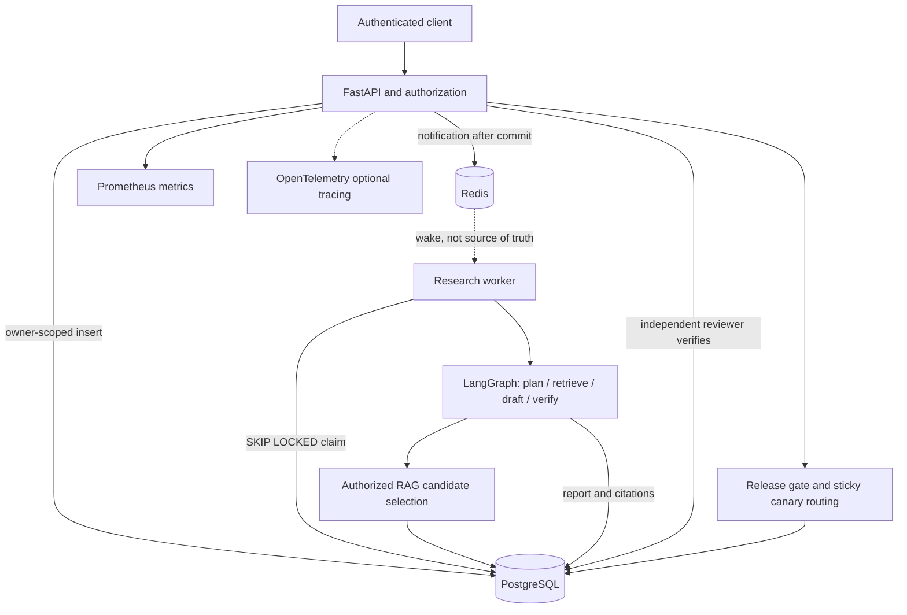

# Architecture and data flow

## Separate trust levels

1. Client request: untrusted, bounded, schema-validated; has no trusted tenant or role field.
2. Authentication result: trusted application configuration identifies tenant, subject, groups, role.
3. Documents: attacker-controlled content even if the caller is authorized to read it. The content is never executed as a tool.
4. Worker graph: application-controlled fixed graph; no dynamic arbitrary Python code or model-nominated unrestricted tool.
5. Approvals: trusted database transition by a distinct reviewer with tenant and group checks; no generated model text can approve.
6. Model registry: operator-supplied evidence with an independent release review; improve with attested metrics before deployment.

## Exact request sequence

1. An editor uploads a document. The service stores `documents` and `chunks` with tenant/group attributes.
2. A researcher submits a bounded question plus idempotency key. The server derives tenant/owner/groups and assigned release version from the principal, writes `research_jobs`, then notifies Redis.
3. The worker polls PostgreSQL if no Redis notification is available; claims a job atomically using conditional updates, PostgreSQL `SKIP LOCKED`, a lease, and a claim generation.
4. LangGraph's *plan* node returns a bounded plan; *retrieve* queries only authorized chunk rows; *draft* returns extractive passages or optional API-generated text; *verify* validates cited source IDs.
5. The worker conditionally commits the output only if it still owns the claim generation, then creates a `pending` approval record.
6. The author can inspect their report. A separate authorized reviewer transitions to `approved` or `rejected`.
7. The release manager can register a model version, store a checked evaluation record, assign a stable canary cohort, observe error rates, promote or roll back. Rollback creates an incident.
8. `/metrics` exposes aggregate HTTP counts and duration histograms only to platform administrators.

## Critical invariants

- Tenants and groups are filtered **before** computing embeddings or ranking candidates.
- An idempotency key cannot be reused to change the question or document group.
- A job's model-version assignment remains fixed after submission.
- A stale worker cannot overwrite a newer worker's DB result.
- A reviewer cannot be the author, must be in the correct tenant, and must have all relevant document groups.
- A candidate cannot reuse an evaluation ID from a different version.
- An admin who registered a version cannot independently approve its canary start or promotion.
- Approved documents may include injection strings as *text*, but never grant execution privileges.

## Why the worker doesn't depend on Redis durability

Queue notification is an optimization. PostgreSQL job rows are authoritative. If Redis loses its notification, the worker polls and rediscovers pending work. This avoids relying on a Redis List as an exactly-once or fully durable queue.

## Failure model

- Lost notification → database poll discovers job.
- Worker crash → lease expires, another worker reclaims.
- Stale worker completion → fenced conditional DB update fails.
- Model call failure → job requeues up to three attempts and then fails.
- Redis unavailable → API rate limiter fails closed, research submission may be unavailable; job data remains intact.
- Incorrect model version → operator-initiated rollback removes it from new assignments; completed work must be reviewed separately.

External tool side effects should use separate idempotency keys, durable receipts, and human approvals; this code never performs external write actions.
